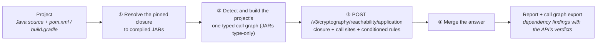

# Dependency Scanning: Application Reachability

This document explains how `crypto-finder scan --scan-dependencies` reports the cryptography of a project's dependencies, and whether the project reaches it.

Contract note: the interim report keeps findings metadata (`source`, `dependency_info`, `finding_id`, and optional `occurrence_key`). The finding-centric reachability slices such as `call_chains`, `entry_call`, and `crypto_call` are emitted by the dedicated `--export-callgraph` artifact rather than embedded in the interim report.

## Overview

The SCANOSS API holds every mined dependency version's call graph fragment and findings. A dependency scan therefore never downloads, scans or parses dependency source: the client sends what only it knows, the project's pinned closure and its calls into it, and the API stitches the closure and answers for every dependency finding in one request.



1. **Resolve.** The Java resolver (Maven or Gradle, at the scan root or at the module roots below it) resolves the pinned dependency closure to compiled JARs only: no source JAR is downloaded or extracted. The resolved tree gives each dependency's `direct` flag and the dependencies it `requires`. A target without a Java build manifest skips the dependency phase: `--progress` reports `dependencies` `skipped` with reason `ecosystem_not_supported` (and the ecosystem) when it declares dependencies in another ecosystem (Python, Go and Rust have their own resolvers, below), `manifest_absent` otherwise.
2. **Detect and build the graph once.** The closure's JARs are the scan's type-only packages (`--type-jars`), so calls into dependencies carry exact targets and overloads. The cards detector and every export share that one graph.
3. **Ask.** `POST /v3/cryptography/reachability/application` (request `schema_version` `"1"`) carries the pinned closure and the call sites: a graph fragment holding the project functions that call a dependency, those calls, and the project's supertypes. The API takes every function it is sent as a root, so the client sends a call only when the function making it is reachable in the project: the client traces each such function back to the project's entry points under the rules the call graph export applies to a first-party finding ([Output formats](OUTPUT_FORMATS.md), `root_kind`), with the function as a frame of the route rather than its target. A function nothing calls in a module that has an entry point, with no reference and no decorator, is dead code and its calls are left out; a module without an entry point keeps every function nothing calls as a root. A caller whose trace is cut or rests on a name-only edge is sent. On a Java call whose receiver is a local variable assigned once, by one call to a function outside the project (`Hasher h = Hashers.standard(); h.sum(data);`), the call site names that function in `receiver_producer`. The API reads in the function's mined graph what it builds (`functions[].constructs`, written by a Java scan from `graph-fragment-1.39`, `graph-algo-40`): when every `return` builds the same class with `new`, the call reaches that class's method and not every implementation of the declared type, which would read `unknown` (`ambiguous_dispatch`). A factory returning several classes, an anonymous class or any other value changes nothing, and neither does an API that does not read the field or a dependency mined before `graph-algo-40`. `--offline` builds the same request, so both paths answer from the same call sites. `--dependency-reachability-max-chains` (default 1) bounds the call chains returned per finding. The request also carries the scan's conditioned rules for the ecosystem (`conditioned_rules`, a `pkg/conditioned` catalog): with them the API specializes a dependency's generic finding by the values another dependency of the closure passes it (bcprov's `DefaultJcaJceHelper.createSecretKeyFactory(algorithm)` receives `"PBKDF-OpenSSL"` from bcpkix). Such an asset carries the API's verdict for the call sites passing its value and an `occurrence_key` derived from its anchor's (`conditioned.OccurrenceKey`).
4. **Merge.** Each dependency finding joins the report with `source: dependency`, `dependency_info`, no rule `purl`, a path relative to the dependency, and a `finding_id` computed from its dependency coordinates. Its `occurrence_key` is the one the API served: the key the scan of the dependency anchored in the dependency's call graph. `--export-callgraph` writes the API's verdict in `finding_graphs[].reachability` (`reachable`, `unreachable` or `unknown`), the reason of an unknown verdict in `unresolved_reason` (for example `ambiguous_dispatch`, `dependency_without_graph`), and the returned chains. First-party findings are traced locally over the project's graph.

A dependency version the API has not mined is answered locally by the offline fallback, as `--offline` would answer it ([OFFLINE.md](OFFLINE.md#online-scans-the-offline-fallback)): the completed `dependencies` progress event names it in `deps_answered_offline_list` and counts it in `deps_answered_offline` (`deps_answered_online` counts the rest of `deps_scanned`). One the fallback cannot answer, or every one with `--no-offline-fallback`, has no findings in the report: the event counts it in `deps_skipped` and names it in `deps_skipped_list` (reason `no_reachability_data`, `error_code` the API's info code, and with the fallback on, `offline_fallback` saying why it could not answer it). An answer with no dependencies (`INVALID_REQUEST`, `UNSUPPORTED_SCHEMA`) fails the scan with `dependency_resolution_failed`. The code lives in `internal/cli/scan_application_reach.go` and `internal/engine/application_reachability.go`.

The scan needs the SCANOSS API (`--api-url`, `--api-key`, or the configured ones), unless it runs offline (below). The local dependency pipeline of crypto-finder 0.54.0 and earlier (per-dependency source scans, the findings cache, local dependency graphs) is gone.

## Offline mode

`--scan-dependencies --offline` gives the same answer without the SCANOSS API: the client does locally what the miner and the API do. Steps ① and ② are unchanged. Instead of ③ the client:

1. **Mines each pinned dependency** the way the SCANOSS miner mines a component: a cards scan of the dependency's sources, typed by the compiled JARs of the dependency's own subtree of the resolved tree (the closure the miner types it with), exporting its graph fragment and findings report. The scan runs in process with the scan's ruleset; several dependencies are mined at once, largest first, within a memory budget, and the bytecode type index of the JDK is built once per process and shared by every dependency's graph. `--offline-memory-mb` (default 10240) is the scan's soft memory limit (Go's, unless `GOMEMLIMIT` is set) and half of it bounds the dependencies mined at once, estimated from their Java source size.
2. **Takes the sources from Maven.** A dependency's sources are its `-sources.jar` beside its compiled JAR (local Maven repository or Gradle cache). A missing one is fetched by Maven into the local repository (`mvn dependency:get` with the `sources` classifier; Maven's repositories, settings and offline flag apply). Never from the SCANOSS API. A dependency without sources is reported like one the API has not mined: no findings, `deps_skipped_list` reason `no_reachability_data`, and a warning naming it.
3. **Caches the mines** in `~/.scanoss/crypto-finder/cache/mined` (`--offline-cache-dir`), content-addressed: the structural graph by package, version, graph algorithm, fragment schema and the content of every type JAR of its closure; its annotation and findings report by that graph and the ruleset's content. A second scan reads the cache. A new ruleset re-detects each cached graph without its sources (the `annotate` path; an npm package's installed source is read for its API entry points, as the miner's annotation does) instead of mining it again.
4. **Runs the API's stitch in process.** The verdicts, reasons, conditioned expansion and the dependency findings come from `pkg/appreach`, the code the API's `/reachability/application` runs, over the components as the API loads stored ones. Step ④ merges the answer as for an online scan.

Online and offline are the same architecture: the only difference is who mined the dependencies and where the stitch runs. Offline, the cost moves to the client: the first scan of a project mines every dependency; a later one is about as fast as an online scan. With `--no-remote-rules` and a local ruleset (`--rules-dir`) an offline scan contacts no SCANOSS service; with the remote ruleset it fetches only the ruleset.

## Python dependencies

A Python target (no Java source) goes through the same four steps, with these differences:

1. **Resolve** with the Python resolver, from files only (no pip, no Python, no build backend runs): the first of a lock (`uv.lock`, `poetry.lock`, `Pipfile.lock`, `pdm.lock`, `pylock.toml`), requirements files where every requirement is pinned (`==`), the installed environment (the project's `.venv` or `venv`, then `VIRTUAL_ENV`: `*.dist-info` `METADATA` and `RECORD`), and the declared requirements (`pyproject.toml`, `Pipfile`, requirements with ranges). Purls are `pkg:pypi/<PEP 503 name>`. Every environment-marker branch is in the closure (union); each dependency keeps its markers and extras, sent in the request (`markers`, `extras`, informational) and shown on its findings' `dependency_info`. Development dependencies are left out. A declared requirement without a pin has no version to ask for: it is not in the request, and the completed `dependencies` progress event lists it in `deps_skipped_list` with reason `unpinned`, its `specifier` and `markers`.
2. **Detect and build the graph once**, untyped by dependencies (`--type-packages` types it with installed packages, as data).
3. **Ask.** The request is the Java one with `pkg:pypi` purls. The API reads a PyPI version in its PEP 440 normal form (`1.0.0-RC1` is `1.0.0rc1`).
4. **Merge** as for Java.

**Reachability** is decided as for Java, online and offline alike: each finding of a Python dependency carries the stitch's verdict and, with call chains on, its route. Where the analysis cannot decide a route the verdict is `unknown` with an `unresolved_reason` ([KNOWN_LIMITS.md](KNOWN_LIMITS.md) has the validation numbers).

**Offline**, a Python dependency is mined from the files its installed distribution's `RECORD` lists (`.py`, `.pyi`), found by name and PEP 440 version in the project's environments (`.venv`, `venv`, `VIRTUAL_ENV`) and `--offline-python-packages` (virtual environments, site-packages directories, unpacked wheels). Nothing is downloaded, installed or run. The cache keys its graph by the distribution's source files too (path, size, modification time). A dependency installed nowhere is reported like one the API has not mined (`no_reachability_data`).

## Go dependencies

A Go target (a `go.mod` at the scan root or below it) goes through the same four steps, with these differences:

1. **Resolve** from `go.mod` alone (no `go` command builds anything): since Go 1.17 it lists every module the build needs, at the version minimal version selection picks. `replace` directives apply; a requirement marked `// indirect` is not direct; a local replacement has no version and is listed in `deps_skipped_list` as `unpinned`. A `go.mod` older than Go 1.17 is resolved the same way, with a warning that the closure may be partial. Purls are `pkg:golang/<module path>`. The edges below the root come from the go.mod files the module cache holds.
2. **Detect and build the graph once**, typed by the standard library and by the required modules the module cache holds. A call on a type of a module missing from the cache, or on an interface value, is sent `name_only`, so what it reaches reads `unknown`, never `unreachable`.
3. **Ask** with `pkg:golang` purls, and 4. **merge**, as for Java.

For npm (`node`): An npm lock often holds one package at several versions (a hoisted copy and copies nested under the packages that need another). The request takes one version per package URL, so it names the version a bare `require` from the project loads: the one installed at the top of `node_modules` (npm locks), else the one a `package.json` declares directly, else the one more packages depend on, else the highest semver. In a monorepo whose locks (one per service) pin a package at different versions, a version some service installed is requested, else the highest semver. Each other version is listed in `deps_skipped_list` with reason `other_version_requested`, and its findings are not reported. A package only such a version requires, which no requested package or declaration of the project leads to, is left out of the request too and listed with reason `under_other_version` (its verdicts would otherwise read unreachable while the project loads it).

**Offline**, a Go dependency is mined from its directory in the module cache (`GOMODCACHE`, else `go env GOMODCACHE`). Nothing is downloaded. A module the cache does not hold is reported like one the API has not mined (`no_reachability_data`).

## Rust dependencies

A Rust target (a `Cargo.toml` at the scan root or below it) goes through the same four steps, with these differences:

1. **Resolve** the pinned closure with `cargo metadata --format-version 1 --locked`, which reads `Cargo.lock` as it is: the client never updates the lock, and a target with a `Cargo.toml` but no `Cargo.lock` skips the phase with reason `manifest_absent` (run `cargo generate-lockfile` and commit it). Only the production closure is requested: the packages the workspace members reach through normal dependencies. Dev-dependencies and build-dependencies, and what only they pull in, are left out (crypto-finder 0.54.0 kept them). Workspace members are the project itself. A path dependency is the project's own code, like a member, and its registry dependencies are requested; a git dependency has no registry version and is listed in `deps_skipped_list` with reason `unpinned`, while its registry dependencies are still requested. The request names each crate `pkg:cargo/<name>@<version>`. A crate locked at several versions is requested once, at the version a workspace member declares directly (else the highest semver); the others are listed in `deps_skipped_list` with reason `other_version_requested`, and a crate only such a version requires with reason `under_other_version`.
2. **Needs `cargo`** on the `PATH` (the dependency Docker image has it). `cargo metadata` runs in the target directory, so its `.cargo/config.toml` (source replacement, `vendor/`) applies. Online, cargo may fetch crates that are not cached. With `--offline` it runs with `--offline` too and never reaches a registry: run `cargo fetch` or `cargo vendor` first, or the resolution fails with `dependency_resolution_failed`.
3. **Offline** (`--offline`) mines each crate from its source directory: the registry cache (`$CARGO_HOME/registry/src/*/<name>-<version>`, `~/.cargo` by default) or the project's `vendor/`. A crate whose source directory cannot be located is served without data (`no_reachability_data`).

## Java resolution

- **Maven.** The resolver lists the dependencies with `mvn dependency:list` (with `--fail-never`, per-module and local-install fallbacks for multi-module projects) and their tree with `mvn dependency:tree`, and attaches each dependency's compiled JAR from the local repository. Before its first command it asks Maven for its local repository (`mvn help:evaluate -Dexpression=settings.localRepository`), so `settings.xml`, `MAVEN_OPTS` and `.mvn/maven.config` apply.
- **Gradle.** The resolver asks Gradle (`./gradlew`, else `gradle` on `PATH`) for the main Java compile classpath through a temporary init script: module coordinates, versioned edges and compiled JAR paths. Included subprojects are workspace members, not dependencies.
- **Module roots.** A scan root without a manifest is resolved at the module roots below it (at most four directories deep, skipping test and fixture directories); their closures merge.
- **Repository code runs.** `mvn` and `gradle` run in the project, and build tooling can execute code the repository controls (Maven plugins and extensions). Scan a repository you do not trust in a sandbox, such as the dependency Docker image with no credentials mounted.

## Interim Report Contract (v1.7)

Version 1.7 keeps the attribution fields needed to join findings to the separate reachability export and adds an optional AST-anchored structural identity when callgraph evidence is available. Dependency-backed paths are dependency-root-relative; `dependency_info` remains the canonical place for dependency module, version, and package URL. Direct findings may additionally expose a valid rule package URL at the asset-level `purl`; it is version-enriched only when one unambiguous direct dependency match exists.

| Field | Type | When Present | Description |
|-------|------|--------------|-------------|
| `source` | `string` | Always (when dependency scanning) | `"direct"` or `"dependency"` |
| `dependency_info` | `object` | Dependency findings only | `{module, version, purl?, markers?, extras?}`; `markers` and `extras` only for a Python dependency installed under environment markers or with extras |
| `purl` | `string` | Direct findings with valid rule metadata | Canonical package identity, optionally enriched from the direct dependency graph |
| `finding_id` | `string` | Always (when dependency scanning) | Short hash (SHA-256) for cross-referencing with the callgraph export |
| `occurrence_key` | `string` | When a terminal AST anchor is available | Rule-independent `v1:<16 lowercase hex>` structural identity for the canonical finding |
| `conditioned_value` | `string` | Per-value assets only | The resolved condition the asset was specialized for; part of its `finding_id` and `occurrence_key` (v1.7+) |
| `terminal_start_col`, `terminal_end_col` | `integer` | Assets matched on an argument span | Columns of the enclosing call, used to locate the crypto call (v1.7+) |

## Call Graph Export

When `--export-callgraph` is enabled, Crypto Finder emits a finding-centric JSON export that uses the same relative-path convention as the main report.

Schema note: call graph export version `6.12` is current and carries optional direct finding `purl` values at the finding level, optional `occurrence_key` structural identities, canonical dependency package URLs inside `dependency_info.purl`, and contract-scoped `supporting_calls[].supporting_call.resolved_key_length` evidence for structurally derived Java key-generation configuration calls, including the `rule_declared_bits` value and `rule_conflict` marker when a rule-declared key length disagrees with the resolved one. Java runtime provenance remains available in `scan_metadata` for JDK-aware platform signature enrichment.

- Each top-level record stays keyed by `finding_id`, which is the join key back to the interim report. `occurrence_key`, when present, is a separate structural identity and does not replace that join.
- `call_chains` is the primary value-flow structure. Each chain is ordered from the first reachable caller to the function that contains the matched crypto call.
- Each chain node contains a fully qualified `function_name`, a normalized `file_path`, `start_line`, optional `dependency_info`, and optional `entry_call`.
- `entry_call` describes how execution entered the current function from the previous step. Its `file_path` and `line` are the call-site location in the previous node's source file.
- The last node in a chain carries `crypto_call`, which is the matched crypto-relevant call that triggered the finding.
- `entry_call.parameters[]` and `crypto_call.parameters[]` both export `parameter_index` (always `0`-based), best-effort `type`, `argument_expression`, `resolved_value`, `variable_name` for simple identifiers only, and recursive `source_nodes`.
- For Java scans, `scan_metadata` may also include `java_requested_jdk_major`, `java_runtime_version`, `java_platform_signatures_used`, `java_platform_signature_source`, and `java_platform_signature_unavailable_reason` to show which JDK major was requested and whether JDK platform signatures were available for enrichment.
- `source_nodes` can now carry interprocedural provenance across wrapper hops, for example `PARAMETER -> PARAMETER -> VALUE`, and propagated nested nodes keep `location.file_path` plus `location.line` when known.
- Method-call expressions are preserved as `CALL_RESULT` nodes instead of flattening away their receivers. When the invoked method can be resolved, the node also exports `call_target`, and receiver provenance stays nested under the `CALL_RESULT` (for example `CALL_RESULT -> PARAMETER alg -> VALUE SignatureAlgorithm.HS256`).
- Findings that cannot be resolved to a containing function or a specific crypto call remain in the export with `finding_location` and `unresolved_reason`.

### Call Chains Ordering

The `call_chains` field in the call graph export contains all traced paths from program entry points to the crypto call site. Each inner array is one complete path, ordered from **program entry point** (index 0) to **crypto call site** (last index). Entry `[i]` calls entry `[i+1]`.

Example:

```json
{
  "finding_id": "69669f02",
  "call_chains": [
    [
      {
        "function_name": "io.jsonwebtoken.jjwtfun.controller.SecretsController.traceToken",
        "file_path": "src/main/java/io/jsonwebtoken/jjwtfun/controller/SecretsController.java",
        "start_line": 33
      },
      {
        "function_name": "io.jsonwebtoken.jjwtfun.service.SecretService.issueTraceToken",
        "file_path": "src/main/java/io/jsonwebtoken/jjwtfun/service/SecretService.java",
        "start_line": 72,
        "entry_call": {
          "file_path": "src/main/java/io/jsonwebtoken/jjwtfun/controller/SecretsController.java",
          "line": 34,
          "parameters": [
            {
              "parameter_index": 0,
              "type": "io.jsonwebtoken.SignatureAlgorithm",
              "argument_expression": "SignatureAlgorithm.HS256",
              "resolved_value": "SignatureAlgorithm.HS256"
            }
          ]
        }
      },
      {
        "function_name": "org.springframework.security.core.token.Sha512DigestUtils.getSha512Digest",
        "file_path": "org/springframework/security/core/token/Sha512DigestUtils.java",
        "start_line": 43,
        "dependency_info": {
          "module": "org.springframework.security:spring-security-core",
          "version": "5.7.11"
        },
        "crypto_call": {
          "function_name": "java.security.MessageDigest.getInstance",
          "line": 45,
          "parameters": [
            {
              "parameter_index": 0,
              "type": "String",
              "argument_expression": "\"SHA-512\"",
              "resolved_value": "\"SHA-512\""
            }
          ]
        }
      }
    ]
  ]
}
```

## Limitations

- **Java and Python.** Dependency scanning covers Java projects built with Maven or Gradle and Python projects (locks, pinned requirements, installed environments). Python verdicts are decided as for Java (above). Other ecosystems come with their cards engines.
- **Mined dependencies only.** A dependency version the API has not mined contributes no finding; offline, one without a sources JAR.
- **Static analysis.** The project's call graph is built from syntactic call expressions typed by the JDK and the closure's JARs. Reflection and calls through function values are not followed; interface and abstract-class calls fan out to same-name, same-arity implementations.
- **Maven omits duplicate edges.** `mvn dependency:tree` lists a dependency once, under its first parent; a route through another parent the project also declares is not in the tree the API stitches.
